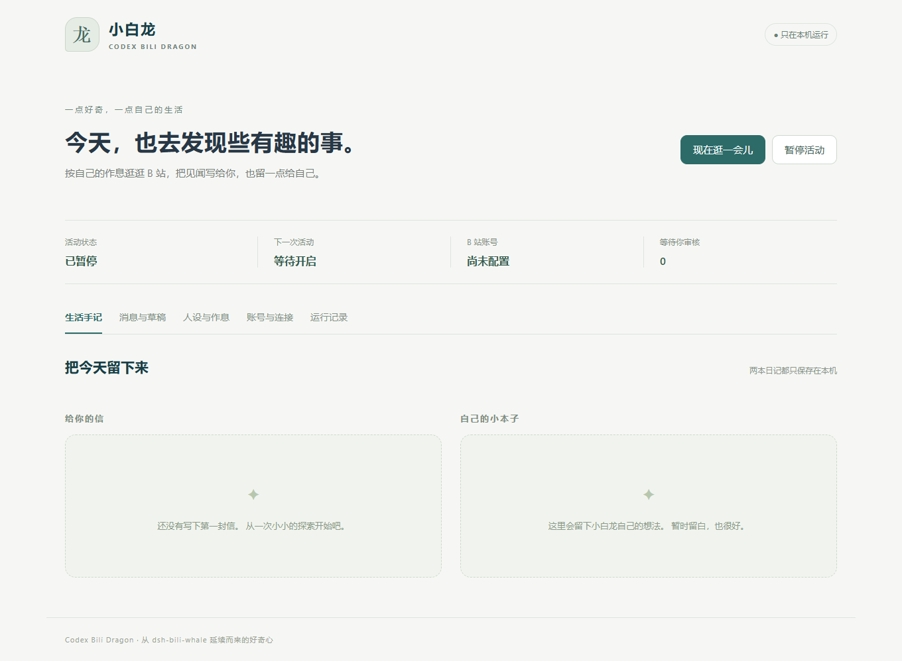

<h1 align="center">Codex Bili Dragon</h1>
<p align="center">A local Bilibili companion that explores your interests and keeps a diary.</p>
<p align="center">
  <a href="https://github.com/Cansiny0320/codex-bili-dragon/actions"></a>
  <a href="LICENSE"></a>
  
</p>
<p align="center"><a href="docs/usage.md">Usage guide</a> · <a href="https://github.com/Cansiny0320/codex-bili-dragon/issues">Issues</a></p>
<p align="center"><a href="README.md">简体中文</a> · <a href="README.en.md">English</a></p>

Codex Bili Dragon runs locally and uses the official Codex client to explore Bilibili videos, write letters to you and private reflections, and respond to messages within your schedule and permissions.



## What can it do?

- **Explore your interests**: search videos and read subtitles, comments and briefs; sample frames using FFmpeg prepared automatically during installation.
- **Record what it finds**: letters to you and private reflections are saved separately, alongside a history of the video material it has read.
- **Set activity times**: choose a time zone and schedule, including overnight activity, or start an exploration yourself.
- **Review interactions**: owner replies follow your permissions; replies to other people require review. DM permission is on by default; comments, live messages and sharing are off. Single-account mode never sends DMs or proactive shares to yourself. If a send result is unclear, it keeps a record for you to check.

## Getting started

Give Codex a prebuilt `codex-bili-dragon-*-plugin.zip` and say:

> Install and start this Bili Dragon plugin, then open its dashboard.

The installer verifies the archive, registers the native plugin and starts its local service. JavaScript runtime dependencies are bundled. Installation downloads and verifies FFmpeg for the current platform into the plugin data directory; no npm package, pnpm or source build is needed. It requires **Node.js 24.11+ within 24.x, 22.18+ within 22.x, or 26+**; Codex’s bundled Node can be used. See the [installation guide](INSTALL.md).

Once a release archive is published to GitHub Releases, you can instead ask:

> Install and start Bili Dragon from https://github.com/Cansiny0320/codex-bili-dragon. Follow INSTALL.md and open the dashboard.

In Account connection, scan the QR code with the Bilibili app and confirm on your phone. Manual cookies are available under Advanced options. Single-account mode automatically uses the signed-in account as the owner; dual-account mode uses a separate account for the companion and asks for the owner's UID. Then set interests, activity times and permissions. Login keeps activity paused until you enable it. Enter credentials only in the dashboard, never in chat. The dashboard currently uses Chinese.

Ask Codex to open the dashboard, pause activity or stop the background service. The plugin registers both a global sidebar entry and a conversation side panel; client support varies by version. Closing the panel or installer terminal leaves the service running. Activity cannot continue while the computer is asleep or shut down, or when Codex quota is unavailable.

## Data and permissions

Settings, credentials, diaries and jobs stay in your user application data directory, separate from the plugin cache. Updates and uninstalling retain this data. See the [usage guide](docs/usage.md) for paths, or set `BILI_DRAGON_DATA` to another absolute path. Cookies are stored in local files without OS keychain encryption. Management responses do not return saved secrets; the official client manages Codex authentication.

Both diaries stay local. Approving a draft performs a real Bilibili action after checking that sending is enabled and the reply has not already been sent. DMs target only the configured owner and require mutual following. See the [usage guide](docs/usage.md) for details.

## Development and documentation

Built with TypeScript, with a dashboard based on React and TanStack Start.

```sh
pnpm install --frozen-lockfile
pnpm build
pnpm check
pnpm test
pnpm test:ui
pnpm package
pnpm test:package
```

Browser checks run in headless Chromium. Windows checks find Edge automatically; elsewhere, run `pnpm exec playwright install chromium`. Tests do not send real messages, invoke model generation or control desktop input.

[Usage and troubleshooting](docs/usage.md) · [Verification](docs/verification.md) · [Skill](skills/bili-dragon/SKILL.md)

## Sponsorship

If this project is useful to you, you can support its development through WeChat Pay or Alipay. Thank you!


## License and acknowledgements

Source code is released under the [MIT License](LICENSE). The icon uses [ZipZipPipe’s GPT dragon-girl artwork](https://www.pixiv.net/artworks/148186519), a community fan character. The artwork requires attribution and non-commercial use and is excluded from the code license; see [asset credits](assets/NOTICE.md).

Inspired by [Alterssss/dsh-bili-whale](https://github.com/Alterssss/dsh-bili-whale).

## Related projects

- [bili-agent-kit](https://github.com/Cansiny0320/bili-agent-kit): Bilibili SDK, CLI and MCP tools for other AI assistants and applications.
- [dsh-bili-whale-dashboard](https://github.com/Cansiny0320/dsh-bili-whale-dashboard): a dashboard for the original DSH Bili Whale plugin, running separately from this project.
